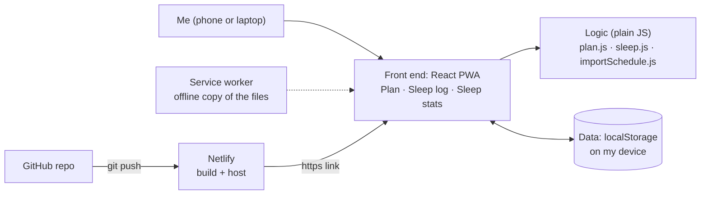
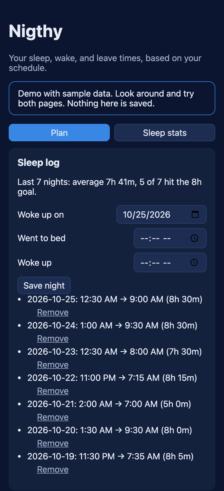
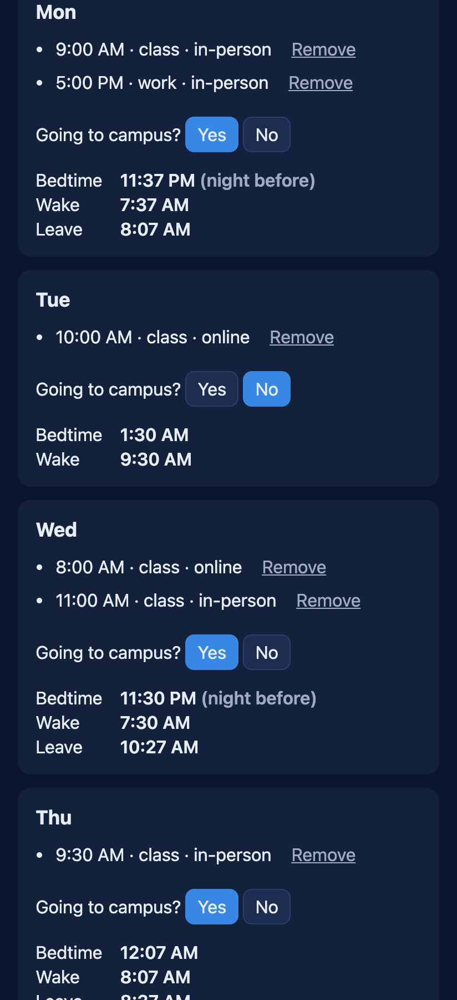
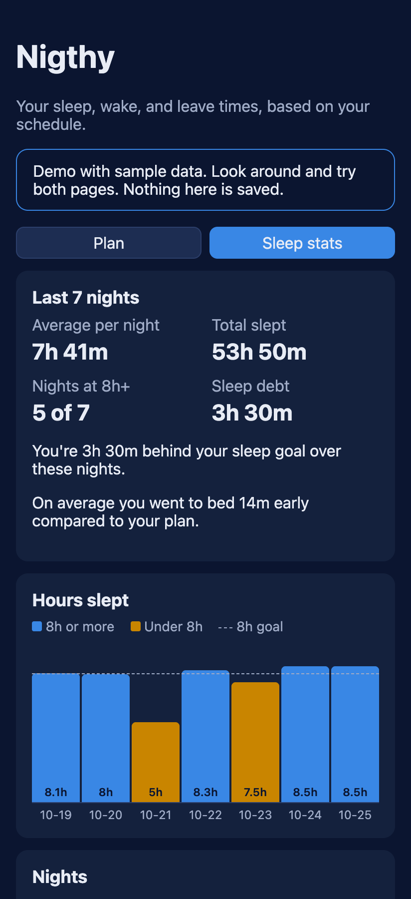

# Nigthy

> A Lehman commuter student (me) decides when to sleep, wake up, and leave, so I
> can reach my first class on time despite an unpredictable commute.

**Author:** Kevin Mitre · **Course:** CMP 464/343 Product 1 · **Last updated:** Oct 25, 2026

**Live app:** https://vermillion-bubblegum-896cf3.netlify.app · [Jump to Demo](#demo)

---

## 1. About Me (the User)

I'm a commuter student at Lehman College, and I also work. My week mixes
in-person classes, online classes, and work shifts, so my first class starts at
a different time almost every day. My commute is about 33 minutes by train, and
morning trains often run about 20 minutes late. I want my sleep, wake, and
leave times in one place, on my phone and on my laptop.

**The last 3 times this happened:**

1. **Monday and Wednesday mornings (10 AM in-person class).** I had trouble
   waking up and had to work out what time to sleep and leave my house, while
   switching between Google Maps and the MTA app to check my commute.
2. **The night before an early class.** I was checking my schedule and
   assignments. I knew I had an early class, but I didn't know what time I
   should realistically go to sleep. I stayed up later than planned, then had
   to choose between less sleep and being late. The next day I was tired in
   class and had less energy for schoolwork.
3. **Planning my week.** My class schedule and work schedule are in different
   places (my class schedule is a PDF), so I had to redo the math by hand for
   each day. I wanted to put my schedule in once and have the times worked out
   for me.

**What it costs me:**

- ⏱️ **Time:** 15–30 minutes each time I work out my times and check my commute.
- 💸 **Money:** a $3.00 fare each way, plus money spent on food when I run out
  of time to meal prep.
- 🔋 **Energy:** after a short night I'm tired in class and have less energy
  for schoolwork.
- 🙂 **Joy:** mornings feel rushed and stressful, and my day feels shorter.

---

## 2. Problem Statement

**Gut check:**

> I need **to know exactly when to sleep, wake up, and leave each day**
> because **my class times change every day and my morning commute is
> unpredictable.**

**Five Whys:**

1. **Why am I late or tired in class?** Because I go to sleep too late.
2. **Why do I go to sleep too late?** Because I don't know what time I should
   realistically sleep for tomorrow.
3. **Why don't I know?** Because I'd have to work it out every night from my
   class time, my commute, and train delays.
4. **Why is that hard?** Because my first class changes every day and morning
   trains run late, so planning ahead feels like a hassle and unpredictable.
5. **Why does it matter?** Because planning the night before is the only way to
   protect my sleep. Without it, I lose time, energy, and focus the next day.

**Problem statement:**

> **When** it's late at night, past my bedtime, and I have class the next day,
> **I struggle to** wake up and leave on time, or I wake up really late and
> don't get much done,
> **which costs me** 15–30 minutes of planning, hours of my day I could have
> used, and money on food when I could have meal prepped.
> **This happens because** I miscalculate my sleep hours: my class times change
> every day and my morning commute has delays.
> **Right now I** try to wake up earlier, **but** I still go to bed late, so I
> end up short on sleep and tired in the morning.

**I'll know this is solved when:** I know my bedtime the night before without
doing any math, I leave on time for my first class, and I sleep 8 hours on most
nights (at least 5 of 7 on my Sleep stats page), with more energy for my tasks
the next day.

---

## 3. Existing Solutions

| What I use or tried | What it does well | Why it falls short *for me* |
|---|---|---|
| Google Sheets | I can plan my week in it | I don't check it, and it doesn't work out my bedtime for me |
| Google Maps + MTA app | Real train times and directions | I have to check both every morning, and they don't tell me when to sleep |
| Waking up earlier | I get an early start | I still sleep late, so I'm fatigued in the morning |
| Going to sleep earlier | I get enough sleep | My day feels shorter, and without a plan I don't stick to it |

**The gap:** I need an assistant that plans my sleep, wake, and leave times the
night before, based on my real schedule and commute, while helping me learn
about my sleep habits.

---

## 4. Features & Benefits

| Feature (what it does) | Benefit (how my life gets better) | MVP or Later? |
|---|---|---|
| **Daily plan:** bedtime, wake, and leave time for each day, from my schedule, a 33 min commute, and a 20 min morning train buffer | I know the night before when to sleep, with no math and no switching apps | **MVP** ✅ built |
| **Sleep log:** record when I went to bed and woke up | I see how much I actually sleep, not what I think I sleep | **MVP** ✅ built |
| **Phone + desktop install, works offline** | It's with me at night on my laptop and on the train in the morning, even underground | **MVP** ✅ built |
| **"Going to campus?"** per day | Online-only days don't make me wake up early for a commute | ✅ built (extra) |
| **Paste my schedule:** paste class lines, preview, add all | I put my week in once, without typing each class | ✅ built (extra) |
| **Sleep stats:** weekly average, total, sleep debt, bedtime vs plan, bar chart | I learn my sleep habits and can see if they're improving | ✅ built (extra) |
| **First-time demo** with sample data | Anyone (like my professor) sees how it works right away | ✅ built (extra) |
| Real commute times from Google Maps | A more accurate leave time | Later |
| Bedtime reminders (notifications) | A nudge before it gets too late | Later |
| Upload my schedule as a PDF or photo | No copying or pasting at all | Later |
| Latest-bedtime setting | No very late bedtimes on days my class starts late | Later |

**MVP (the skateboard):**
- Daily plan (bedtime, wake, leave) from my schedule and commute
- Sleep log
- Works on my phone and my laptop (installable, offline)

*Changed since my first draft:* I first listed "mobile version with
notifications" as MVP. I moved notifications to Later so I could finish a
working plan and sleep log first.

**Later:**
- Real transit times from the Google Maps (Routes) API, through a small server
  that keeps the API key secret
- Bedtime reminder notifications
- Upload a schedule PDF or photo and have AI (Gemini) read it, plus sleep tips
  based on my syllabus
- One-tap "Going to bed" / "I'm awake" buttons
- A latest-bedtime setting

**Not doing:**
- Scaling to many users. It's a solo app for me (3 users at most).
- Accounts or syncing between devices.
- A native Android / Play Store app.
- Automatic sleep detection. A web app can't read the phone's sleep sensors.

---

## 5. Tech Stack

### Front end
- **Surface:** Web app, installable as a PWA (Progressive Web App) on my
  Android phone and usable on my laptop.
- **Tools:** React + Vite (JavaScript), plain CSS, a hand-written service
  worker.
- **Why:** I have this problem at night (planning on my laptop or phone) and in
  the morning on the go (phone). One web app covers both, installs from Chrome
  with no app store, and works offline underground.

### Back end

| Piece | Choice | Why |
|---|---|---|
| Server / API | None (for now) | All the math runs on my device, and there's nothing secret to hide yet. Later, a Netlify Function will hold the Google Maps API key. |
| Data storage | Browser localStorage | It's private data for one person: free, instant, and works offline. Trade-off: data doesn't sync between my phone and laptop. |
| Outside services | None yet (Google Routes API later) | Keeps it free, and no API keys in my code. |
| Hosting / deploy | Netlify (free) + GitHub | Gives the `https://` link Android needs to install the app, and rebuilds automatically on every push. |

### Architecture sketch



**One action, step by step: tapping "Save night"**
1. `SleepLog.jsx` reads the form (date, bedtime, wake time) and calls `onSave`.
2. `App.jsx` (`saveNight`) adds the night to the `sleepLog` state, replacing
   any night with the same date.
3. A `useEffect` saves the new list to localStorage under `nigthy-sleep`.
4. React redraws the screen, and `sleep.js` recalculates the average, sleep
   debt, and chart.

There's no server: nothing leaves my device.

---

## 6. Open Questions

- Is the Google Routes API's free monthly amount enough for me, and is a
  Netlify Function the simplest safe place for the key?
- Should there be a latest bedtime? My 2 PM class on Tue/Thu gives a 4:57 AM
  bedtime, which is a big swing from 12:37 AM on Mon/Wed.
- How do bedtime reminders work for an installed web app on Android?
- Is there a simple way to sync my phone and laptop without accounts?

---

## Demo

**Live app (open on any device):**
**https://vermillion-bubblegum-896cf3.netlify.app**

- The first visit opens a **demo with sample data**: a week of classes, a
  short midterm night, and a full Sleep stats page. Tap **Skip demo** to start
  with your own empty planner.
- **Install on Android:** open the link in Chrome, tap **⋮**, then
  **Install app** (or **Add to Home screen**).

**Screenshots (phone size, demo data):**

| Plan page & sleep log | Daily plans | Sleep stats |
|---|---|---|
|  |  |  |

---

## How It Works

### Settings

| Setting | Value |
|---|---|
| Sleep goal | 8 hours |
| Get-ready | 30 min |
| Commute | 33 min |
| Train delay buffer | 20 min, only if leaving between 6:00 and 9:30 AM |

### Events

Each class or work shift is an event:

| Field | Values | Example |
|---|---|---|
| Type | class or work | class |
| Mode | in-person or online | in-person |
| Day | Mon–Sun | Mon |
| Start time | 24-hour time | 09:30 |

### Going to campus (yes/no)

- A day with an in-person event defaults to **yes**.
- A day with only online events **asks me** yes or no.
- A day with no events shows my **sleep summary** instead of a plan.

### How the plan is calculated

**On a campus day (yes):** the plan starts from the earliest in-person event.

1. Leave time = event start − 33 min commute
2. If that leave time is between 6:00 and 9:30 AM, leave 20 min earlier for
   train delays
3. Wake time = leave time − 30 min to get ready, or earlier if an online
   event starts before that
4. Bedtime = wake time − 8 hours

If an online-only day is marked "yes", the plan starts from the earliest
online event instead.

**On a home day (no):** no leave time. Wake time = earliest event − 30 min,
and bedtime = wake time − 8 hours.

**Example: my Monday, in-person class at 10:00 AM**

| Step | Time |
|---|---|
| 10:00 − 33 min commute | 9:27 AM (inside 6:00–9:30, so add the buffer) |
| Leave (− 20 min buffer) | 9:07 AM |
| Wake (− 30 min get-ready) | 8:37 AM |
| Bedtime (− 8 hours) | 12:37 AM |

### Paste your schedule

Paste one class or shift per line. The app shows a preview first, then adds
everything with one tap. It understands lines like:

```
Mon & Wens CMP 410 - 10AM - 11:40AM In person
Tuesday & Thursdays CMP 408: 6:00PM - 7:40PM Virtual
MoWe 9:00AM - 10:15AM
```

- **Days:** full names, short names, plurals, and CUNYfirst codes like `MoWe`.
- **Time:** the first time with `:` or AM/PM is the start time. Course numbers
  like `410` are ignored.
- **Mode:** "Virtual", "Online", "Remote", or "Zoom" means online. No mode
  written means in-person, and the preview marks it "(assumed)".
- Lines it can't read are listed so I can fix them. Pasting the same schedule
  twice doesn't create duplicates.

### Sleep log and stats

I log the date I woke up, when I went to bed, and when I woke up. Logging the
same date again replaces that night. The **Sleep stats** page shows the last 7
nights:

- **Average per night** and **total slept**
- **Nights at 8h+**
- **Sleep debt:** how far the short nights fell below 8 hours, added up. Long
  nights don't cancel short ones (8h, 5h, 9h → 3h of debt).
- **Bedtime vs plan:** how much earlier or later I went to bed than my plan
  (planned 11:37 PM, went to bed at 1:00 AM → "1h 23m late").
- A **bar chart** of hours slept with an 8-hour goal line. Nights under 8h are
  amber, with a legend and the hours written on each bar.
- A **table** with each night's bed, wake, total, and bedtime vs plan.

### First-time demo

The first visit shows sample data so the plan and stats are filled in right
away. Demo data is never saved, so it can't mix with real data. **Skip demo**
switches to my real data, and **View demo** brings the demo back.

---

## Privacy & Security

- All data stays in the browser on my own device. Nothing is sent to a server.
- No API keys or passwords are in the code. `.env` files are listed in
  `.gitignore`, and future API keys will live in Netlify's private settings,
  used by a server function, never in the front end.

## Running Locally

Needs Node 22.

```
npm install      # download the libraries (once)
npm run dev      # start the app at http://localhost:5173
npm run build    # make the final version in dist/
npm run lint     # check the code for common mistakes
```
